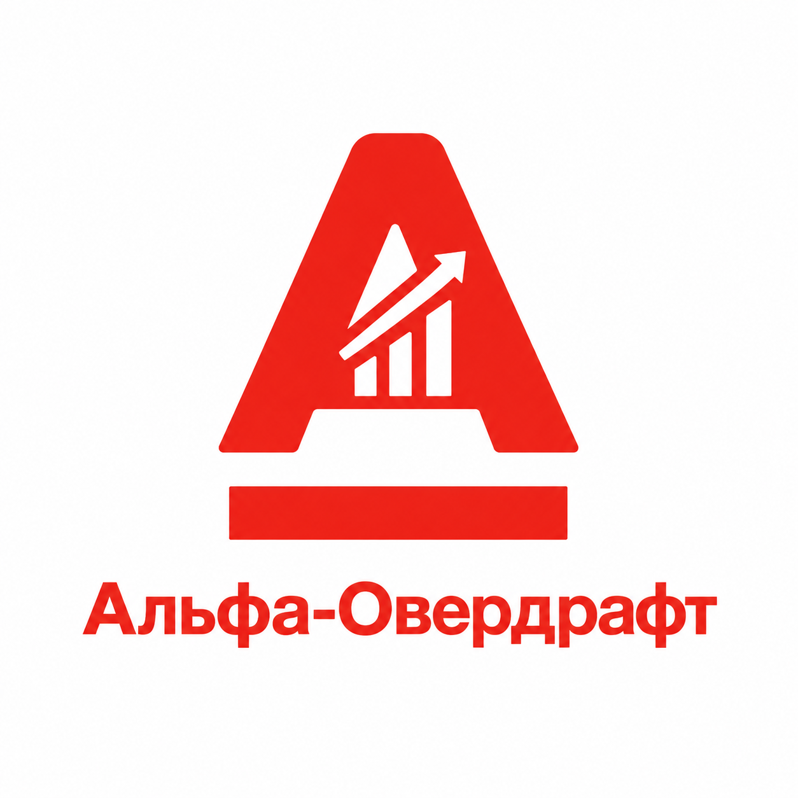
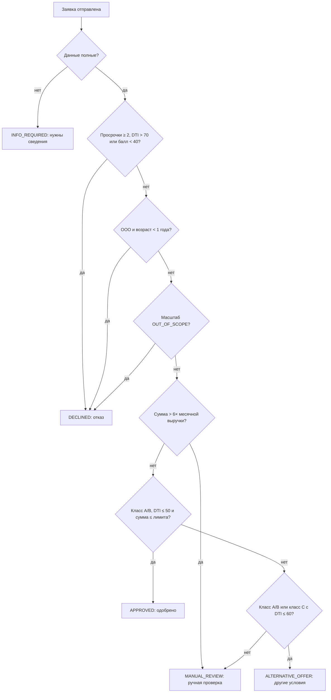

# Альфа-Овердрафт — Умный кредитный кабинет предпринимателя

> ## 🚀 Демо уже развёрнуто и доступно онлайн
>
> Сайт работает на VDS-сервере — **ничего устанавливать не нужно**, достаточно открыть ссылку:
>
> ### 👉 [http://168.113.170.158/](http://168.113.170.158/)
>
> | | |
> | --- | --- |
> | 🌐 **Приложение** | [http://168.113.170.158/](http://168.113.170.158/) |
> | 📖 **Swagger UI** | [http://168.113.170.158/swagger-ui/index.html](http://168.113.170.158/swagger-ui/index.html) |
> | 📄 **OpenAPI JSON** | [http://168.113.170.158/v3/api-docs](http://168.113.170.158/v3/api-docs) |
>
> 🔑 На странице входа есть кнопки **быстрого входа** в каждый демо-профиль. Также можно войти вручную по логину и паролю — [все учётные записи](#демо-аккаунты).

**Двусторонняя платформа кредитования малого и микробизнеса (ИП и ООО)**



## Продуктовое решение

Мы отказались от концепции «просто красивой формы заявки с чат-ботом». Главная боль малого бизнеса (ММБ) при кредитовании — это неопределенность. Предприниматели не понимают, сколько денег им дадут, почему требуют те или иные документы, и из-за чего в итоге пришел отказ. 

Наше решение — это **связанный процесс для двух сторон**. Мы сделали процесс кредитования абсолютно прозрачным для клиента и легко управляемым для сотрудника банка.

**Продукт состоит из трех ключевых модулей:**

### 1. Клиентский кабинет (Для ИП и ООО)
Первоначальное создание заявки на овердрафт начинается не с каталога продуктов, а с бизнес-задачи (кассовый разрыв, налоги, закупка оборудования). 
* **Минимум ручного ввода:** Система сама подтягивает данные из моков ЕГРИП/ЕГРЮЛ, профиля клиента и реестра МСП. Предприниматель только проверяет данные, а не вводит их заново.
*   **ИИ-ассистент: автоматизация рутины, а не принятие решений:** Вместо ручного заполнения формы клиент может описать бизнес-задачу свободным текстом (например: *«Требуется 1,5 млн рублей на закупку оборудования, срок — два месяца»*). LLM-модель извлекает параметры и корректно предзаполняет анкету. При этом ИИ выступает исключительно в роли умного интерфейса и не принимает кредитных решений — это гарантирует предсказуемость, безопасность и соответствие банковскому комплаенсу.
*   **Адаптивные сценарии для ИП и ООО:** Архитектура решения учитывает правовые и финансовые различия форм собственности. Для индивидуальных предпринимателей путь максимально упрощен. Для юридических лиц (ООО) система автоматически рассчитывает масштаб бизнеса (по годовой выручке и штату), верифицирует полномочия представителя (генерального директора) и формирует пул дополнительных требований к корпоративной отчетности.
*   **Прозрачное ценообразование и трекинг:** Предприниматель в реальном времени видит статус рассмотрения заявки. Сразу после автоматического предварительного скоринга система демонстрирует расчетный лимит, присвоенный класс риска и точную процентную ставку, которая будет зафиксирована в итоговой оферте.

### 2. Кредитное ядро и скоринг
Мы исключили практику «непрозрачных отказов», которая является главным демотиватором для бизнеса. В основе конвейера лежит детерминированная модель оценки, учитывающая 8 метрик (данные БКИ, история просрочек, долговая нагрузка — DTI, срок существования бизнеса и полнота данных).

*   **Концепция встречного предложения:** Если запрошенная клиентом сумма превышает допустимую долговую нагрузку, банк не отклоняет заявку. Система автоматически пересчитывает лимит и формирует альтернативный оффер (например, 5 млн рублей вместо 15 млн с соответствующей корректировкой ставки). Это сохраняет лояльность клиента и напрямую увеличивает конверсию в выдачу.
*   **Многофакторный расчет ставки:** Базовая процентная ставка формируется на основе запрошенного срока транша (30 / 60 / 90 дней) и дополнительно масштаба бизнеса (микро / малый) если это ООО. Итоговая ставка динамически корректируется с учетом отраслевых рисков (по ОКВЭД) и присвоенного риск-класса (A, B, C, D).

### 3. Рабочее место сотрудника банка
Полноценный кредитный процесс невозможен без удобных инструментов для внутреннего контроля. Мы разработали специализированный интерфейс для профильных сотрудников банка, разбирающих нестандартные заявки (статус `MANUAL_REVIEW`).

*   **Единое окно принятия решений:** Сотрудник видит агрегированную карточку клиента, результаты скоринга с детализацией по факторам оценки, показатели DTI и данные из внешних реестров.
*   **Экспертный контроль:** Скоринговая система предоставляет рекомендации (например: *«Рекомендуется отказ: возраст компании менее 1 года»*). Сотрудник может согласиться с системой или взять ответственность на себя и одобрить заявку, зафиксировав обоснование в системе аудита.
*   **ИИ-генерация обратной связи:** Нейросеть автоматически формирует черновик комментария для клиента, корректно и понятно объясняя причины принятого банком решения.


[МЕСТО ДЛЯ СКРИНШОТА 1: Дашборд клиента со статусом заявки и предложением (Сумма, срок, ставка)]

[МЕСТО ДЛЯ СКРИНШОТА 2: Интерфейс сотрудника банка с деталями скоринга и кнопками принятия решения]

### Проблема и исследование (CustDev)
В ходе проектирования логики мы провели 12 глубинных интервью с владельцами ИП и финансовыми директорами ООО. Выявленные барьеры напрямую определили архитектуру MVP:

1.  **Страх неизвестности:** Предприниматели часто прерывают заполнение длинных анкет, так как не понимают потенциальный кредитный лимит. *Наше решение:* Система показывает предварительный расчет, DTI и класс риска сразу после ввода базовых данных.
2.  **Непонимание причин отказа:** Неаргументированный отказ вынуждает клиента уйти к конкурентам. *Наше решение:* Детализированная обратная связь от банка и генерация альтернативных условий при пограничном скоринге.
3.  **Дублирование данных:** Бизнес устал вручную вводить реквизиты, которые уже есть у государства и банка. *Наше решение:* Умное предзаполнение на базе открытых API (в рамках хакатона реализовано через моки реестров).

### Ключевые функциональные возможности

В рамках MVP мы сфокусировались на функциях, которые приносят наибольшую ценность для бизнеса и оптимизируют внутренние процессы банка:

*   **Адаптивная анкета (ИП и ООО):** Динамический роутинг шагов заявки в зависимости от вида бизнеса клиента. Снижает когнитивную нагрузку и время на заполнение. 
*   **Интеграция с реестрами:** Автоматическое предзаполнение реквизитов из профиля и моков ЕГРИП/ЕГРЮЛ по ИНН. Исключает ошибки ручного ввода и гарантирует достоверность данных для банка. 
*   **ИИ-заполнение из текста:** LLM-извлечение параметров (сумма, срок, цель) из неструктурированного текста клиента. Быстрый старт без переписывания бизнес-задачи в поля формы.
*   **Автосохранение:** Сохранение прогресса на стороне сервера и локально. Защищает от потери данных и повышает конверсию в отправку заявки.
*   **Система комплаенса и валидации:** Жесткая проверка форматов, лимитов и сбор обязательных юридических согласий до отправки на сервер. Минимизирует возвраты на доработку.
*   **Прозрачный предварительный скоринг:** Оценка по 8 риск-факторам, формирование класса риска (A–D), расчет DTI и расчетного лимита. Снимает эффект «черного ящика» для клиента.
*   **Динамическое ценообразование:** Расчет базовой ставки по масштабу бизнеса и сроку с корректировкой на отраслевые риски и присвоенный риск-класс. 
*   **Встречное предложение:** Автоматическое снижение суммы и пересчет ставки при превышении допустимой долговой нагрузки. Сохраняет клиента в воронке при невозможности выдачи запрошенной суммы.
*   **Единое окно сотрудника банка:** Рабочее место сотрудника банка для разбора очереди заявок, просмотра детализации скоринга, внешних проверок и принятия решения в один клик.
*   **Генерация и подписание документов:** Формирование договора овердрафта и индивидуальных условий с финальными параметрами, проверка версий и имитация электронной подписи. 
*   **Трекинг статуса заявки:** Информирование клиента на всех пяти этапах кредитного конвейера. Снижает тревожность пользователя и нагрузку на поддержку.
*   **Контекстный ИИ-ассистент:** Консультирование по условиям и интерфейсу на базе системного промпта, без права изменения данных и обещания действий.

### Преимущества и принципы

- **Меньше пути до заявки.** Профиль, ИНН и моки регистрационных данных заполняют форму, а текст бизнес-задачи превращается в черновик через ИИ. Клиент проверяет, а не вводит.
- **Понятная цена на каждом шаге.** После подачи клиент видит балл, класс риска, DTI, расчётный лимит и платёж по базовой ставке, а в оферте — итоговую ставку, срок и сумму.
- **Не бинарный отказ.** Если риск допустим, но сумма выше лимита или нагрузка выше порога, продукт предлагает альтернативные условия, а не отказывает.
- **Объяснимое решение.** Скоринг — прозрачная сумма вкладов по 8 факторам: сотрудник видит, за что начислены баллы, и указывает причину решения; клиент видит комментарий банка.
- **Человек в контуре.** Даже при рекомендации «одобрено» заявку подтверждает сотрудник: это снижает риск автоматической ошибки.
- **Один продукт — два сценария.** ИП и ООО проходят разные анкеты и разные правила ставки, но получают одинаково понятный путь и одинаковые статусы.

### Как принимается решение

Скоринг детерминированный: 8 факторов дают до 100 баллов, по баллам определяется класс риска.

| Фактор | Максимум баллов |
| --- | --- |
| БКИ | 20 |
| Просрочки за 12 месяцев | 15 |
| Запросы в БКИ за 12 месяцев | 5 |
| Тренд выручки | 15 |
| Возраст компании | 10 |
| DTI | 20 |
| Сумма к годовой выручке | 10 |
| Полнота данных | 5 |

Класс риска: **A** — 80+, **B** — 60–79, **C** — 40–59, **D** — меньше 40.



Базовые ставки:

| Сегмент | 30 дней | 60 дней | 90 дней |
| --- | --- | --- | --- |
| ИП | 24,50% | 24,75% | 25,00% |
| ООО, MICRO | 20,00% | 22,00% | 24,00% |
| ООО, SMALL | 19,00% | 21,00% | 23,00% |

К ставке добавляется отраслевая надбавка; в альтернативном предложении — ещё надбавка за класс риска (A +0,10, B +0,25, C +0,50 п.п.). Лимит считается от месячной выручки с отраслевым коэффициентом и ограничен 20 млн ₽.

[МЕСТО ДЛЯ СКРИНШОТА 3: рабочее место сотрудника банка — скоринг, DTI, лимит, ставка, рекомендация с причиной, форма решения]


### Границы MVP и план развития

**Реализовано в текущей версии (MVP):**
*   Полноценный и понятный UI/UX для ИП и ООО (от формирования потребности до имитации ЭЦП).
*   Детерминированное кредитное ядро: расчет долговой нагрузки, лимитов, ставок и логика встречных предложений.
*   Рабочее место сотрудника банка (список заявок, детализация скоринга, возможность вынести свой вердикт).
*   Интеграция с LLM с открытыми весами (Mistral Small) для предзаполнения параметров по тексту и генерации комментариев.
*   Генерация, версионирование и просмотр документов по оферте.


&nbsp;
# Техническое решение
## Архитектура и стек

| Слой | Технологии | Назначение |
| --- | --- | --- |
| Frontend | React 19, TypeScript 6, Vite 8, React Router 7 | SPA; организация кода по Feature-Sliced Design |
| UI | Alfa Core Components 50, Alfa Icons, SCSS Modules, Sass | Компоненты и дизайн-токены Альфа-Банка; локальные стили без CSS-in-JS |
| Данные клиента | TanStack Query 5, Zod 4, React hooks | Серверное состояние и кэш; проверка JSON-контрактов; локальное состояние интерфейса |
| Backend | Java 21, Spring Boot 4.1.1, Spring MVC, Spring Data JPA / Hibernate, Bean Validation, Spring Security, springdoc-openapi 3.2.0 | REST API, бизнес-правила, транзакции, проверки доступа и OpenAPI |
| База данных | PostgreSQL 16, Flyway | Постоянное хранение и версионируемые SQL-миграции |
| ML / LLM | Mistral Small 4; Spring RestClient, Apache HttpClient 5, Jackson 3 | Внешний инференс через OpenAI-совместимый HTTP API |
| Сборка и доставка | Node.js 20 в Docker-сборке, Yarn 1.22.22, Gradle Wrapper 9.8.1, Docker Compose, Nginx, GitHub Actions / GHCR | Сборка контейнеров, раздача SPA и проксирование API |

Версии и зависимости заданы в [frontend/package.json](frontend/package.json), [yarn.lock](frontend/yarn.lock) и [backend/SmartCredit/build.gradle](backend/SmartCredit/build.gradle).

В стандартном запуске работают три контейнера:

| Сервис Compose | Внутри контейнера | Связи |
| --- | --- | --- |
| `frontend` | Nginx, порт `80` | Раздаёт собранный SPA; проксирует `/api/`, `/swagger-ui/` и `/v3/api-docs` на `backend:8080` |
| `backend` | Spring Boot, порт `8080` | Обращается к `postgres:5432` и внешнему LLM API |
| `postgres` | PostgreSQL, порт `5432` | Хранит данные в именованном томе `pgdata` |

Основные каталоги:

```text
frontend/src/app, pages, widgets, features, entities, shared   # Слои FSD
backend/SmartCredit/src/main/java/alfa/smartcredit/            # Контроллеры, DTO, сервисы, модели, репозитории
backend/SmartCredit/src/main/resources/db/migration/           # Миграции Flyway
.github/workflows/deploy.yml                                 # Ручной запуск сборки и доставки через GHCR
```

### Frontend: FSD

| Слой в `frontend/src/` | Что в нём находится | Примеры |
| --- | --- | --- |
| `app` | Запуск приложения, провайдеры, общие layouts и глобальные стили | `providers`, `CabinetLayout`, `BankLayout` |
| `pages` | Экраны маршрутов и их композиция | `dashboard`, `bank`, `application-flow`, `login` |
| `widgets` | Крупные блоки экрана, собранные из сущностей и действий | `application-overview`, `bank-workspace`, `ai-copilot-drawer` |
| `features` | Пользовательские действия, их состояние и обработка запросов | `submit-loan-application`, `sign-documents`, `send-ai-message` |
| `entities` | Модели предметной области, Zod-схемы и работа с серверными данными | `company`, `loan-application`, `application-document`, `session` |
| `shared` | Код без привязки к конкретному сценарию | HTTP-клиент, обёртки над Alfa UI, форматирование, конфигурация маршрутов |

Основное направление зависимостей: `pages → widgets → features → entities → shared`; `app` связывает приложение целиком. В текущем коде есть композиция соседних features, например форма использует редактирование профиля.

### Доступ и API

Аутентификация основана на серверном `HttpSession` и cookie **`JSESSIONID`**. В сессии хранится `userId`, время неактивности ограничено двумя часами.

| Роль | Граница доступа |
| --- | --- |
| `CLIENT` | Данные своей компании; клиентские операции с заявками, черновиками, документами и LLM |
| `BANK_OFFICER` | Очередь заявок разных компаний, банковские данные, решения и подсказки сотруднику |
| Без сессии | Вход, публичный каталог демо-профилей и документация API |

Основные маршруты, не полная спецификация:

| Метод | Путь | Доступ | Назначение |
| --- | --- | --- | --- |
| `POST` | `/api/auth/login` | Без сессии | Создание новой сессии |
| `GET` | `/api/auth/me` | Любая авторизованная роль | Текущий пользователь |
| `POST` | `/api/auth/logout` | Без обязательной сессии | Завершение сессии |
| `GET` | `/api/dashboard` | `CLIENT` | Агрегированный снимок кабинета |
| `GET`, `POST` | `/api/applications` | `CLIENT` | Чтение и создание заявок |
| `GET`, `PUT`, `DELETE` | `/api/applications/draft` | `CLIENT` | Черновик компании; контроль конкурентных изменений через `revision` |
| `GET` | `/api/applications/{id}/documents` | `CLIENT` | Документы своей заявки |
| `POST` | `/api/offers/{id}/accept`, `/api/offers/{id}/sign` | `CLIENT` | Серверные переходы состояния оферты и подписи |
| `POST` | `/api/ai/prefill` | `CLIENT` | Извлечение параметров из текста |
| `POST` | `/api/assistant/messages` | `CLIENT` | Ответ LLM с контекстом текущего экрана |
| `GET` | `/api/bank/applications`, `/api/bank/applications/{id}`, `/api/bank/applications/{id}/form` | `BANK_OFFICER` | Чтение банковской проекции данных |
| `POST` | `/api/bank/applications/{id}/decision` | `BANK_OFFICER` | Регистрация решения |
| `POST` | `/api/bank/applications/{id}/comment-suggestion` | `BANK_OFFICER` | Подготовка текста комментария |

API использует JSON и HTTP-коды ошибок. Общая ошибка содержит `code`, `message`, `timestamp`. Например, отсутствие сессии возвращает `401`, недостаточная роль `403`, конфликт версии черновика `409 DRAFT_CONFLICT`. Отсутствующий черновик возвращается как `204`, а создание заявки как `201`.


## ИИ и LLM-модели

**Конфигурация стенда использует только модели с открытыми весами (open-weight). Выбранная модель для всех LLM-вызовов: Mistral Small 4, `mistralai/mistral-small-2603`.** Префикс `OPENAI_` обозначает совместимость API, а не использование моделей OpenAI.

### Модель

| Параметр | Значение |
| --- | --- |
| Модель | Mistral Small 4, версия 26.03 |
| ID у используемого API-шлюза | `mistralai/mistral-small-2603` |
| Общие параметры | **119 млрд** |
| Активные параметры | **Около 6,5 млрд на токен** |
| Архитектура | Mixture-of-Experts: 128 экспертов, 4 активных |
| Окно контекста модели | 256 тыс. токенов; ограничения запросов приложения задаются отдельно |
| Веса | Открыто опубликованы на [Hugging Face][model-weights] |
| Лицензия весов | **Apache License 2.0** |

Apache 2.0 является свободной пермиссивной лицензией: разрешает коммерческое использование, модификацию и распространение. При распространении необходимо соблюдать её условия, в том числе сохранять текст лицензии, применимые уведомления об авторских правах и `NOTICE`, а также отмечать внесённые изменения. Полный текст: [Apache License 2.0][model-license].

### Интеграция

Все обращения выполняются **только с backend** через общий [OpenAiConfig](backend/SmartCredit/src/main/java/alfa/smartcredit/config/OpenAiConfig.java). API-ключ не передаётся браузеру. Запрос отправляется на `POST {OPENAI_BASE_URL}/chat/completions`; результат читается из `choices[0].message.content`.

| Сервис | Контекст и контракт | Поведение при недоступности LLM |
| --- | --- | --- |
| [AiExtractionService](backend/SmartCredit/src/main/java/alfa/smartcredit/service/AiExtractionService.java) | Системный промпт и пользовательский текст; извлечённые поля валидируются на backend. Данные профиля добавляются после извлечения. API возвращает `{form, aiFilled, missingFields}` | Ошибка `503 AI_UNAVAILABLE` или `502 AI_BAD_RESPONSE`; ручной ввод остаётся доступен |
| [AssistantService](backend/SmartCredit/src/main/java/alfa/smartcredit/service/AssistantService.java) | Системный промпт, свежая серверная проекция кабинета и недоверенные `message`, `history`, `screen`. Ответ `{answer, focusFieldId}`; ID проверяется по полям запроса | Явная ошибка, без имитации ответа модели |
| [AiCommentService](backend/SmartCredit/src/main/java/alfa/smartcredit/service/AiCommentService.java) | Скоринговые показатели, рекомендация и предлагаемые условия; результатом является короткий текст | Детерминированный шаблонный комментарий |

### Замена модели

Замена совместимого провайдера или модели **не требует изменения кода**. В `.env` меняются `OPENAI_BASE_URL`, `OPENAI_MODEL`, `OPENAI_API_KEY` и, при необходимости, `OPENAI_RESPONSE_FORMAT`.

- Base URL содержит префикс API, например `https://routerai.ru/api/v1`, **без** `/chat/completions` в конце.
- Имя модели зависит от провайдера. Например, прямой API Mistral использует `mistral-small-2603`, а используемый шлюз (routerai) принимает `mistralai/mistral-small-2603`.
- Провайдер должен поддерживать контракт Chat Completions: `model`, `messages`, Bearer-аутентификацию и `choices[0].message.content`.
- Для предзаполнения и помощника доступны `json_object`, `json_schema` и `text`. Режим `text` только убирает параметр `response_format`: содержимое ответа по-прежнему должно быть JSON. Автоматического переключения форматов нет.

После изменения `.env` пересоздайте backend:

**Перед перезапуском учтите сброс демо-БД:** в текущей конфигурации `APP_DEMO_RESET_DB_ON_STARTUP` по умолчанию равен `true`. Для сохранения данных backend должен получать `APP_DEMO_RESET_DB_ON_STARTUP=false`; в Compose переменную нужно явно передать через `environment`, одного значения в `.env` недостаточно.

```bash
docker compose up -d --force-recreate backend
```

Обычный `docker compose restart` не подхватывает новые переменные окружения.

## Конфигурация и запуск

### Требования

**Для запуска нужен только Docker с Compose v2**: Docker Desktop либо Docker Engine с Compose plugin. Node.js, Java, Gradle и PostgreSQL на хост устанавливать не требуется. Нужны доступ в интернет для первой сборки и LLM API, а также свободные порты `80`, `8080`, `5432`.

### Локальный стенд

Команды выполняются из корня проекта. Используется [docker-compose.yaml](docker-compose.yaml).

**В репозитории нет зашитых API-ключей. Скопируйте `.env.example` в `.env` и заполните пустые поля (в частности API KEY для LLM).** `.env` исключён из Git. Значения ключей нельзя помещать в `VITE_*`, исходники frontend или публикуемые логи.

```bash
cp .env.example .env
```

В PowerShell эквивалентная команда: `Copy-Item .env.example .env`.

После заполнения `.env`:

```bash
docker compose up -d
```

При первом запуске Compose собирает образы из Dockerfile. PostgreSQL проходит healthcheck, затем backend применяет миграции Flyway. Frontend собирается в статические файлы и обслуживается Nginx; Vite dev server в контейнерном запуске не используется.

`up -d` возвращает управление до полной готовности приложения. Состояние и ошибки запуска:

```bash
docker compose ps
docker compose logs --tail=100 backend
```

Проверка синтаксиса конфигурации без вывода значений окружения: `docker compose config --quiet`.

При обновлении исходников существующие образы нужно пересобрать: `docker compose up -d --build`. Остановка: `docker compose down`; том `pgdata` сохраняется. **Не добавляйте `--volumes`, если данные нужно сохранить.**

### Переменные окружения

| Переменная | Значение в `.env.example` | Назначение |
| --- | --- | --- |
| `OPENAI_API_KEY` | Пустое; заполнить для работы ИИ | Серверный ключ выбранного LLM-провайдера |
| `OPENAI_BASE_URL` | `https://routerai.ru/api/v1` | Базовый адрес OpenAI-совместимого API |
| `OPENAI_MODEL` | `mistralai/mistral-small-2603` | Общая модель для извлечения, помощника и комментариев |
| `OPENAI_RESPONSE_FORMAT` | `json_object` | Формат ответа для извлечения и помощника: `json_object`, `json_schema`, `text` |
| `OPENAI_CONNECT_TIMEOUT` | `10s` | Таймаут подключения и ожидания соединения из пула |
| `OPENAI_READ_TIMEOUT` | `100s` | HTTP-таймаут ответа провайдера; не общий deadline пользовательского действия |.

В базовом Compose параметры БД заданы непосредственно через `SPRING_DATASOURCE_URL`, `SPRING_DATASOURCE_USERNAME`, `SPRING_DATASOURCE_PASSWORD`. Порты также фиксированы в `ports`; произвольные `PORT`, `BASE_URL` и `LLM_MODEL_NAME` приложение не читает. `VITE_API_BASE_URL` предусмотрен HTTP-клиентом как переменная времени сборки, но стандартный Docker-сценарий использует относительный `/api/` и не требует её настройки.

### Адреса

| Ресурс | Адрес после запуска |
| --- | --- |
| Frontend | [http://localhost](http://localhost) |
| API текущей сессии | [http://localhost:8080/api/auth/me](http://localhost:8080/api/auth/me); до входа ожидается `401` |
| Swagger UI | [http://localhost/swagger-ui.html](http://localhost/swagger-ui.html); напрямую на backend — [http://localhost:8080/swagger-ui.html](http://localhost:8080/swagger-ui.html) |
| OpenAPI JSON | [http://localhost/v3/api-docs](http://localhost/v3/api-docs); напрямую на backend — [http://localhost:8080/v3/api-docs](http://localhost:8080/v3/api-docs) |
| PostgreSQL | `localhost:5432`, БД `credit_cabinet`; это TCP, не HTTP |

Swagger подключён через `springdoc-openapi`. Для защищённых операций нужна сессия, созданная через `/api/auth/login`. Nginx проксирует `/swagger-ui/`, `/swagger-ui.html` и `/v3/api-docs` на backend, поэтому документация доступна и через frontend-порт. На сервере адрес такой: `http://СЕРВЕР:<HTTP_PORT>/swagger-ui.html`.

### Готовые образы

[docker-compose.prod.yml](docker-compose.prod.yml) является отдельной конфигурацией для готовых образов, а не дополнением к локальному запуску. [Workflow Deploy](.github/workflows/deploy.yml) запускается вручную, публикует образы в GHCR и доставляет их по SSH.

| Дополнительная переменная | Назначение |
| --- | --- |
| `IMAGE_PREFIX` | Префикс образов, например `ghcr.io/organization/project` |
| `IMAGE_TAG` | Тег образов; по умолчанию `latest`, CI передаёт SHA коммита |
| `HTTP_PORT` | Внешний порт Nginx; по умолчанию `80`, только в prod-конфигурации |
| `POSTGRES_PASSWORD` | Пароль БД для prod-конфигурации |

Для этого режима LLM-настройки также задаются явно. Workflow получает их из GitHub Secrets; три параметра формата и таймаутов в prod-конфигурации фиксированы. Для локального запуска жюри эти дополнительные переменные не нужны.

## Тестовые данные и демо-сценарий

### Демо-аккаунты

Войти можно двумя способами: нажать кнопку **быстрого входа** нужного профиля на странице авторизации или ввести логин и пароль вручную. Пароль у всех клиентов — `demo123`, у сотрудника банка — `bank123`.

| № | Логин | Пароль | Роль | ФИО / профиль |
| --- | --- | --- | --- | --- |
| 1 | `demo_ip_approved` | `demo123` | `CLIENT` | Кузнецов Дмитрий Олегович |
| 2 | `demo_ooo_alternative` | `demo123` | `CLIENT` | Морозова Елена Викторовна |
| 3 | `demo_ip_manual` | `demo123` | `CLIENT` | Белова Анна Сергеевна |
| 4 | `demo_ooo_declined` | `demo123` | `CLIENT` | Лебедев Артём Игоревич |
| 5 | `client_ip` | `demo123` | `CLIENT` | Орлов Сергей Андреевич |
| 6 | `client_ooo` | `demo123` | `CLIENT` | Руководитель компании |
| 7 | `officer` | `bank123` | `BANK_OFFICER` | Сидоров Пётр |

> Роль `CLIENT` открывает клиентский кабинет (ИП или ООО), роль `BANK_OFFICER` — рабочее место сотрудника банка.


[МЕСТО ДЛЯ ПОШАГОВОГО ДЕМО-СЦЕНАРИЯ для ЖЮРИ]

## Дополнительные артефакты

| Артефакт | Ссылка или место для заполнения |
| --- | --- |
| Swagger / OpenAPI | Доступны всем прямо на сервере: [Swagger UI](http://168.113.170.158/swagger-ui/index.html) и [JSON-спецификация](http://168.113.170.158/v3/api-docs). Локально: [Swagger UI](http://localhost/swagger-ui.html), [JSON](http://localhost/v3/api-docs) |
| Диаграмма состояний заявки | [МЕСТО ДЛЯ ССЫЛКИ НА STATE MACHINE]; переходы реализованы в [ApplicationService](backend/SmartCredit/src/main/java/alfa/smartcredit/service/ApplicationService.java) |
| Лицензии сторонних компонентов | [THIRD_PARTY_NOTICES.md](THIRD_PARTY_NOTICES.md) |
| Правила frontend | [frontend-rules.md](frontend/docs/frontend-rules.md); фактические зависимости фиксируются в `package.json` и `yarn.lock` |
| Материалы демонстрации | [МЕСТО ДЛЯ СКРИНШОТА_3: Подготовка заявки и контекстный помощник] |

[model-docs]: https://docs.mistral.ai/models/mistral-small-4-0-26-03
[model-weights]: https://huggingface.co/mistralai/Mistral-Small-4-119B-2603
[model-license]: https://www.apache.org/licenses/LICENSE-2.0.txt
