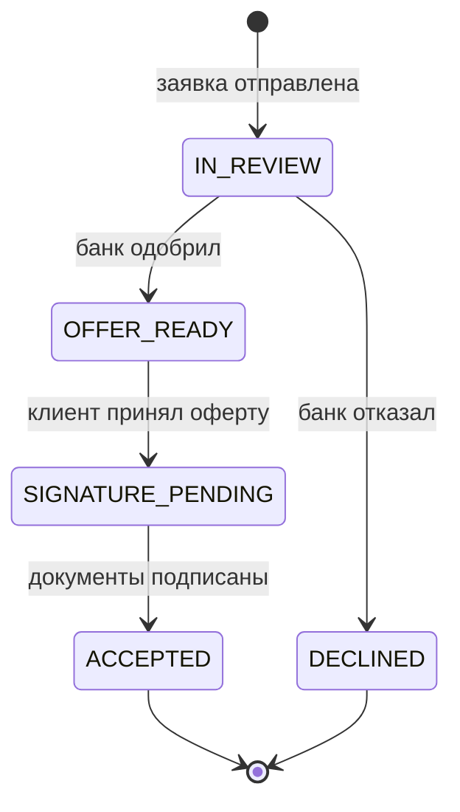
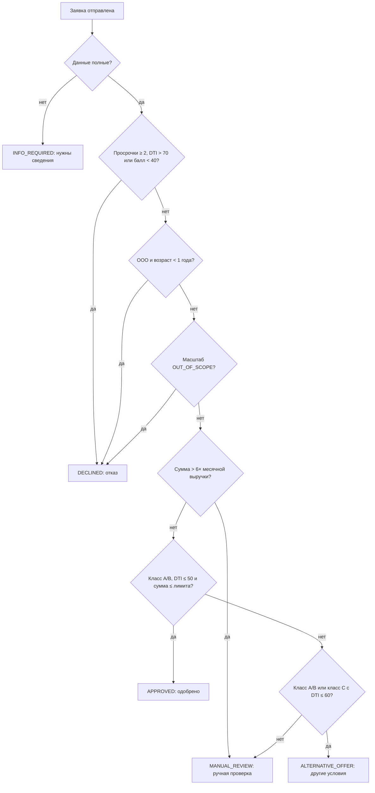

# Умный кредитный кабинет предпринимателя

B2B-кредитный конвейер для ИП и ООО: React-клиент, Spring Boot API, PostgreSQL и интеграция с LLM.

[логотип]

## Продуктовое решение

**Овердрафт, который объясняет себя: от бизнес-задачи до подписанных условий — в одном кабинете, без повторного ввода данных и непонятных отказов.**

[МЕСТО ДЛЯ СКРИНШОТА 1: кабинет клиента с офертой — сумма, срок, ставка, платёж]

### Коротко о продукте

- **Клиент** проходит путь от бизнес-задачи до подписанных документов: анкета, скоринг, предложение банка, принятие условий, два документа и подпись.
- **Сотрудник банка** работает в отдельном кабинете: очередь заявок, карточка со скорингом и внешними данными, рекомендация системы и форма решения.
- **Ядро** детерминированное: 8 факторов на 100 баллов, DTI, персональный лимит, ставка по сроку и масштабу, четыре исхода для заполненной заявки — одобрение, альтернатива, ручная проверка, отказ.
- **ИИ** ускоряет ввод и объяснение, но не принимает кредитное решение: заполняет анкету из текста, отвечает клиенту по серверному снимку данных и готовит комментарий сотруднику.
- **Границы** обозначены явно: выдача денег и график платежей не входят в MVP, а БКИ, ФНС и ЕГРИП/ЕГРЮЛ имитируются моками.

### Проблема и исследование

Мы провели 12 CustDev-интервью — по 6 с индивидуальными предпринимателями и с представителями ООО (директора, финансовые директора, главный бухгалтер). Боли сгруппировались в семь кластеров: от непрозрачного лимита до совместной работы бухгалтера и директора.

| Кластер | Респонденты | Что зафиксировали | Ответ продукта | Статус |
| --- | --- | --- | --- | --- |
| Прозрачность лимита и цены | 1, 2, 11 | «Непонятен доступный лимит», «непрозрачная полная стоимость», боятся потратить время на анкету | Сразу после подачи — балл, класс, DTI, расчётный лимит и платёж; в оферте — итоговая ставка | Частично: ориентир до подачи — P1 |
| Сложная анкета | 4, 8, 12 | Много повторяющихся полей, страх потерять данные, неудобно продолжать с телефона | 4 шага, автозаполнение, черновик, ИИ-заполнение из текста, валидация | Реализовано |
| Подтверждение доходов | 3, 6, 8 | Отчёты площадок и выписки не совпадают, непонятно, какие файлы подходят | Моки ЕГРИП/ЕГРЮЛ по ИНН и финансовые поля в анкете | Частично: отраслевые чек-листы — P2 |
| Непонятное решение | 5, 9, 11 | Неясно, что повлияло на отказ и можно ли исправить данные | Клиенту — балл, класс, DTI и комментарий; сотруднику — разбивка по факторам и причина рекомендации | Реализовано |
| Ожидание и статусы | 7, 10 | Клиент звонит менеджеру и не может планировать | Пять статусов, прогресс по этапам, уведомления | Частично: запрос данных в кабинете — P1 |
| Неподходящие условия | 6, 11 | Отказ от частично подходящего финансирования | Альтернативное предложение с уменьшенной суммой и пересчитанной ставкой | Реализовано |
| Совместная работа | 8, 12 | Бухгалтер готовит, директор подтверждает, ошибки всплывают поздно | Отдельных ролей и подтверждения директором нет; ответственность за данные не разделена | Вне MVP, P2 |

Характерные формулировки из интервью:

> «Непонятен доступный лимит… не начинал заявку: опасался потратить время» — респондент 1, ИП, кофейня.
>
> «Непрозрачная полная стоимость… считал переплату вручную и спрашивал менеджера» — респондент 2, ИП, магазин одежды.

Полные портреты и ответы — [МЕСТО ДЛЯ ССЫЛКИ НА CUSTDEV].

### Как исследование изменило продукт

Таблица ниже — наша интерпретация интервью и продуктовые выводы, а не дословные утверждения респондентов.

| Что предполагали сначала | Что показало исследование | Что сделали в продукте |
| --- | --- | --- |
| Главное — быстро отправить заявку | Клиент бросает анкету не из-за скорости, а из-за неопределённости: лимит, цена, сохранение данных | Сделали акцент на прозрачности расчёта, черновике и автозаполнении, а не только на сокращении полей |
| Решение банка — бинарное: одобрено или отказ | При допустимом риске клиент готов на меньшую сумму, но не готов к отказу | Добавили альтернативное предложение с лимитом и надбавкой за класс риска |
| Клиенту достаточно статуса «на рассмотрении» | Клиент не понимает, что повлияло на решение и что делать дальше | Показали балл, класс, DTI и лимит, а сотруднику — факторы и причину рекомендации |
| ИИ может вести заявку вместо клиента | Доверие к автоматическому решению низкое, ошибки в данных дороги | Оставили ИИ в роли ассистента: заполнение, ответы, комментарий; решение принимает человек |
| Все поля анкеты равнозначны | Часть данных банк уже получает из профиля и реестров, клиент вводит только то, что определяет потребность | Разделили ручной ввод и автозаполнение; клиент подтверждает данные, а не перепечатывает |

### Для кого

| Роль | Задача | Что получает |
| --- | --- | --- |
| ИП | Быстро понять цену денег и не тратить день на анкету | Короткий путь, ставка по сроку, автозаполнение, черновик, понятный статус |
| ООО: директор, финдир, бухгалтер | Подготовить заявку из отчётности и согласовать условия | Учёт масштаба бизнеса, отдельные шаги «ООО и финансы» и «Проверка организации», документы и подпись |
| Сотрудник банка | Быстро разобрать очередь и принять объяснимое решение | Скоринг с разбивкой, внешние проверки, рекомендация системы, ИИ-комментарий, решение в один экран |

### Ключевые фичи

| Фича | Что делает | Зачем бизнесу | Статус |
| --- | --- | --- | --- |
| Анкета из 4 шагов | Параметры финансирования → данные бизнеса → регистрационные данные → проверка и согласия. Для ИП и ООО набор шагов различается | Снижает длину и когнитивную нагрузку заявки | Реализовано |
| Черновик | Сохраняет незавершённую анкету и восстанавливает её при возврате | Клиент не теряет введённое и возвращается к заявке | Реализовано |
| Автозаполнение | Подставляет профиль, ИНН и регистрационные данные из моков ЕГРИП/ЕГРЮЛ; клиент подтверждает | Убирает повторный ввод и ошибки | Реализовано, внешние источники — моки |
| ИИ-заполнение из текста | Разбирает описание бизнес-задачи и предлагает заполненные поля | Быстрый старт без переписывания задачи в поля | Реализовано; без модели — ошибка и ручное заполнение |
| Валидация и согласия | Проверяет обязательные поля, форматы, срок и согласия до отправки | Меньше возвратов на доработку | Реализовано |
| Прозрачный скоринг | 8 факторов на 100 баллов, класс риска A–D, DTI и расчётный лимит | Решение не выглядит «чёрным ящиком» | Реализовано |
| Персональный лимит и ставка | Лимит от выручки и отрасли; ставка ИП по сроку, ООО — по масштабу и сроку | Клиент видит реалистичные условия | Реализовано, правила демонстрационные |
| Альтернативное предложение | Ограничивает сумму лимитом и пересчитывает ставку с надбавкой за класс | Вместо отказа — частично подходящее финансирование | Реализовано |
| Рабочее место банка | Очередь, поиск, фильтры, карточка заявки, скоринг, внешние данные, рекомендация, решение | Сотрудник разбирает заявку в одном экране | Реализовано |
| Оферта и документы | Сумма, срок, ставка, платёж, срок действия; договор овердрафта и индивидуальные условия; версия и подпись | Путь не обрывается на решении банка | Реализовано в демонстрационном виде |
| Статусы и уведомления | Пять статусов заявки, прогресс по этапам, уведомления в кабинете | Клиент понимает, что происходит и что дальше | Реализовано |
| ИИ-помощник | Отвечает на вопросы по данным кабинета, не меняет данные и не обещает действий | Снимает часть вопросов без звонка менеджеру | Реализовано |
| Роли «подготовил / подтвердил» | Бухгалтер готовит, директор подтверждает | Совместная работа над заявкой в ООО | Вне MVP, P2 |
| Выдача кредита и график платежей | Зачисление, транши, платежи | Полный кредитный цикл | Вне MVP |

### Преимущества и принципы

- **Меньше пути до заявки.** Профиль, ИНН и моки регистрационных данных заполняют форму, а текст бизнес-задачи превращается в черновик через ИИ. Клиент проверяет, а не вводит.
- **Понятная цена на каждом шаге.** После подачи клиент видит балл, класс риска, DTI, расчётный лимит и платёж по базовой ставке, а в оферте — итоговую ставку, срок и сумму.
- **Не бинарный отказ.** Если риск допустим, но сумма выше лимита или нагрузка выше порога, продукт предлагает альтернативные условия, а не отказывает.
- **Объяснимое решение.** Скоринг — прозрачная сумма вкладов по 8 факторам: сотрудник видит, за что начислены баллы, и указывает причину решения; клиент видит комментарий банка.
- **Человек в контуре.** Даже при рекомендации «одобрено» заявку подтверждает сотрудник: это снижает риск автоматической ошибки.
- **Один продукт — два сценария.** ИП и ООО проходят разные анкеты и разные правила ставки, но получают одинаково понятный путь и одинаковые статусы.

### Клиентский путь

1. **Вход.** Демо-профили покрывают четыре исхода: одобрение, альтернативные условия, ручная проверка и отказ.
2. **Выбор формы.** Если она не задана, кабинет просит выбрать ИП или ООО — от этого зависят шаги анкеты и правила расчёта.
3. **Анкета.** Четыре шага: параметры финансирования, данные бизнеса, регистрационные данные, проверка и согласия. Поля подставляются из профиля и моков ЕГРИП/ЕГРЮЛ; текст бизнес-задачи можно превратить в заполненную форму через ИИ. Черновик сохраняется между сессиями.
4. **Отправка и скоринг.** Заявка уходит в банк, клиент видит статус «На рассмотрении», а в карточке — балл, класс риска, DTI, расчётный лимит и платёж по базовой ставке.
5. **Решение банка.** Сотрудник одобряет заявку, предлагает альтернативные условия или отказывает; комментарий обязателен.
6. **Оферта.** Клиент видит сумму, срок, ставку, ежемесячный платёж и срок действия предложения.
7. **Подписание.** Принятие оферты переводит заявку в `SIGNATURE_PENDING`, затем клиент подписывает договор овердрафта и индивидуальные условия. После подписи заявка получает `ACCEPTED`.



Выдача денег и график платежей в MVP не входят: `ACCEPTED` означает подписанные документы, а не зачисление кредита.

[МЕСТО ДЛЯ СКРИНШОТА 2: анкета — шаг с ИИ-заполнением из описания бизнес-задачи, текст задачи, кнопка заполнения, подставленные поля]

### Как принимается решение

Скоринг детерминированный: 8 факторов дают до 100 баллов, по баллам определяется класс риска.

| Фактор | Максимум баллов |
| --- | --- |
| БКИ | 20 |
| Просрочки за 12 месяцев | 15 |
| Запросы в БКИ за 12 месяцев | 5 |
| Тренд выручки | 15 |
| Возраст компании | 10 |
| DTI | 20 |
| Сумма к годовой выручке | 10 |
| Полнота данных | 5 |

Класс риска: **A** — 80+, **B** — 60–79, **C** — 40–59, **D** — меньше 40.



Базовые ставки:

| Сегмент | 30 дней | 60 дней | 90 дней |
| --- | --- | --- | --- |
| ИП | 24,50% | 24,75% | 25,00% |
| ООО, MICRO | 20,00% | 22,00% | 24,00% |
| ООО, SMALL | 19,00% | 21,00% | 23,00% |

К ставке добавляется отраслевая надбавка; в альтернативном предложении — ещё надбавка за класс риска (A +0,10, B +0,25, C +0,50 п.п.). Лимит считается от месячной выручки с отраслевым коэффициентом и ограничен 20 млн ₽.

[МЕСТО ДЛЯ СКРИНШОТА 3: рабочее место сотрудника банка — скоринг, DTI, лимит, ставка, рекомендация с причиной, форма решения]

### Путь сотрудника банка

1. **Очередь.** Все заявки с поиском, фильтрами по статусу и сортировкой по дате, сумме и компании.
2. **Карточка.** Анкета, запрошенные условия, скоринг по 8 факторам, DTI, расчётный лимит, базовая ставка, отраслевая надбавка, зона БКИ, рекомендация системы с причиной и ИИ-комментарий.
3. **Решение.** `APPROVE`, `OFFER_ALTERNATIVE` (можно изменить сумму, срок и ставку) или `DECLINE`. Комментарий обязателен и виден клиенту.
4. **Принцип.** Система рекомендует, человек решает. Рекомендация не перезаписывает решение и не выдаёт себя за одобрение банка.

### Границы MVP

| Что | Статус |
| --- | --- |
| Анкета ИП и ООО, черновик, автозаполнение, согласия | Реализовано |
| Скоринг, DTI, лимит, ставка, решение и альтернатива | Реализовано, правила детерминированные |
| Очередь и рабочее место сотрудника банка | Реализовано |
| Оферта, два документа, версия документов, подпись | Реализовано в демонстрационном виде |
| Уведомления и статусы | Реализовано |
| ИИ-заполнение, ИИ-помощник, ИИ-комментарий | Реализовано; комментарий имеет шаблонный fallback, остальные ИИ-функции без модели возвращают ошибку |
| БКИ, ФНС, ЕГРИП/ЕГРЮЛ | Моки по ИНН; в демо-сценариях можно переопределить |
| Ставки, лимиты и пороги | Демонстрационные, требуют продуктовой и правовой проверки |
| Документы и подпись | Тексты без юридической силы, ЭП имитируется |
| Выдача кредита, график платежей, бухгалтерская роль | Вне MVP |

Продукт честно показывает, где заканчивается демонстрация: `ACCEPTED` означает подписанные документы, а не зачисление кредита. Это осознанная граница MVP, а не скрытое ограничение.

### Демо за 3 минуты

| Логин | Роль | Что смотреть | Ожидаемый исход |
| --- | --- | --- | --- |
| `demo_ip_approved` | ИП | Оферта уже сформирована: принять и подписать документы | Одобрено |
| `demo_ooo_alternative` | ООО | Заявка ждёт сотрудника: войти как `officer` и предложить другие условия | Альтернатива |
| `demo_ip_manual` | ИП | Пограничный случай: балл 42, просрочка, падающая выручка | Ручная проверка |
| `demo_ooo_declined` | ООО | Отказ из-за возраста компании меньше года объяснён в комментарии | Отказ |
| `officer` | Сотрудник банка | Очередь, скоринг, рекомендация, решение | — |

Пароли демо-клиентов — `demo123`, сотрудника банка — `bank123`. Запуск и переменные окружения описаны ниже, в технической части README.

### Что дальше

Приоритеты из CustDev сведены в один продуктовый порядок: в исследовании две версии списка P0–P2, которые расходятся в деталях.

- **P1.** Предварительный ориентир лимита и ставки до подачи заявки — самая частая боль интервью.
- **P1.** Запрос недостающих документов и данных в кабинете, история действий, объяснение ключевых факторов клиенту без раскрытия модели.
- **P2.** Роли «подготовил / подтвердил», отраслевые чек-листы документов, учёт сезонности.
- **P2.** Реальные интеграции БКИ/ФНС/ЕГРЮЛ, выдача кредита и график платежей, аналитика воронки и качества скоринга.


## Архитектура и стек

| Слой | Технологии | Назначение |
| --- | --- | --- |
| Frontend | React 19, TypeScript 6, Vite 8, React Router 7 | SPA; организация кода по Feature-Sliced Design |
| UI | Alfa Core Components 50, Alfa Icons, SCSS Modules, Sass | Компоненты и дизайн-токены Альфа-Банка; локальные стили без CSS-in-JS |
| Данные клиента | TanStack Query 5, Zod 4, React hooks | Серверное состояние и кэш; проверка JSON-контрактов; локальное состояние интерфейса |
| Backend | Java 21, Spring Boot 4.1.1, Spring MVC, Spring Data JPA / Hibernate, Bean Validation, Spring Security, springdoc-openapi 3.2.0 | REST API, бизнес-правила, транзакции, проверки доступа и OpenAPI |
| База данных | PostgreSQL 16, Flyway | Постоянное хранение и версионируемые SQL-миграции |
| ML / LLM | Mistral Small 4; Spring RestClient, Apache HttpClient 5, Jackson 3 | Внешний инференс через OpenAI-совместимый HTTP API |
| Сборка и доставка | Node.js 20 в Docker-сборке, Yarn 1.22.22, Gradle Wrapper 9.8.1, Docker Compose, Nginx, GitHub Actions / GHCR | Сборка контейнеров, раздача SPA и проксирование API |

Версии и зависимости заданы в [frontend/package.json](frontend/package.json), [yarn.lock](frontend/yarn.lock) и [backend/SmartCredit/build.gradle](backend/SmartCredit/build.gradle).

В стандартном запуске работают три контейнера:

| Сервис Compose | Внутри контейнера | Связи |
| --- | --- | --- |
| `frontend` | Nginx, порт `80` | Раздаёт собранный SPA; проксирует `/api/`, `/swagger-ui/` и `/v3/api-docs` на `backend:8080` |
| `backend` | Spring Boot, порт `8080` | Обращается к `postgres:5432` и внешнему LLM API |
| `postgres` | PostgreSQL, порт `5432` | Хранит данные в именованном томе `pgdata` |

Основные каталоги:

```text
frontend/src/app, pages, widgets, features, entities, shared   # Слои FSD
backend/SmartCredit/src/main/java/alfa/smartcredit/            # Контроллеры, DTO, сервисы, модели, репозитории
backend/SmartCredit/src/main/resources/db/migration/           # Миграции Flyway
.github/workflows/deploy.yml                                 # Ручной запуск сборки и доставки через GHCR
```

### Frontend: FSD

| Слой в `frontend/src/` | Что в нём находится | Примеры |
| --- | --- | --- |
| `app` | Запуск приложения, провайдеры, общие layouts и глобальные стили | `providers`, `CabinetLayout`, `BankLayout` |
| `pages` | Экраны маршрутов и их композиция | `dashboard`, `bank`, `application-flow`, `login` |
| `widgets` | Крупные блоки экрана, собранные из сущностей и действий | `application-overview`, `bank-workspace`, `ai-copilot-drawer` |
| `features` | Пользовательские действия, их состояние и обработка запросов | `submit-loan-application`, `sign-documents`, `send-ai-message` |
| `entities` | Модели предметной области, Zod-схемы и работа с серверными данными | `company`, `loan-application`, `application-document`, `session` |
| `shared` | Код без привязки к конкретному сценарию | HTTP-клиент, обёртки над Alfa UI, форматирование, конфигурация маршрутов |

Основное направление зависимостей: `pages → widgets → features → entities → shared`; `app` связывает приложение целиком. В текущем коде есть композиция соседних features, например форма использует редактирование профиля.

### Доступ и API

Аутентификация основана на серверном `HttpSession` и cookie **`JSESSIONID`**. В сессии хранится `userId`, время неактивности ограничено двумя часами.

| Роль | Граница доступа |
| --- | --- |
| `CLIENT` | Данные своей компании; клиентские операции с заявками, черновиками, документами и LLM |
| `BANK_OFFICER` | Очередь заявок разных компаний, банковские данные, решения и подсказки сотруднику |
| Без сессии | Вход, публичный каталог демо-профилей и документация API |

Основные маршруты, не полная спецификация:

| Метод | Путь | Доступ | Назначение |
| --- | --- | --- | --- |
| `POST` | `/api/auth/login` | Без сессии | Создание новой сессии |
| `GET` | `/api/auth/me` | Любая авторизованная роль | Текущий пользователь |
| `POST` | `/api/auth/logout` | Без обязательной сессии | Завершение сессии |
| `GET` | `/api/dashboard` | `CLIENT` | Агрегированный снимок кабинета |
| `GET`, `POST` | `/api/applications` | `CLIENT` | Чтение и создание заявок |
| `GET`, `PUT`, `DELETE` | `/api/applications/draft` | `CLIENT` | Черновик компании; контроль конкурентных изменений через `revision` |
| `GET` | `/api/applications/{id}/documents` | `CLIENT` | Документы своей заявки |
| `POST` | `/api/offers/{id}/accept`, `/api/offers/{id}/sign` | `CLIENT` | Серверные переходы состояния оферты и подписи |
| `POST` | `/api/ai/prefill` | `CLIENT` | Извлечение параметров из текста |
| `POST` | `/api/assistant/messages` | `CLIENT` | Ответ LLM с контекстом текущего экрана |
| `GET` | `/api/bank/applications`, `/api/bank/applications/{id}`, `/api/bank/applications/{id}/form` | `BANK_OFFICER` | Чтение банковской проекции данных |
| `POST` | `/api/bank/applications/{id}/decision` | `BANK_OFFICER` | Регистрация решения |
| `POST` | `/api/bank/applications/{id}/comment-suggestion` | `BANK_OFFICER` | Подготовка текста комментария |

API использует JSON и HTTP-коды ошибок. Общая ошибка содержит `code`, `message`, `timestamp`. Например, отсутствие сессии возвращает `401`, недостаточная роль `403`, конфликт версии черновика `409 DRAFT_CONFLICT`. Отсутствующий черновик возвращается как `204`, а создание заявки как `201`.

[скрин "Рабочее место сотрудника банка"]

## ИИ и LLM-модели

**Конфигурация стенда использует только модели с открытыми весами (open-weight). Выбранная модель для всех LLM-вызовов: Mistral Small 4, `mistralai/mistral-small-2603`.** Префикс `OPENAI_` обозначает совместимость API, а не использование моделей OpenAI.

### Модель

| Параметр | Значение |
| --- | --- |
| Модель | Mistral Small 4, версия 26.03 |
| ID у используемого API-шлюза | `mistralai/mistral-small-2603` |
| Общие параметры | **119 млрд** |
| Активные параметры | **Около 6,5 млрд на токен** |
| Архитектура | Mixture-of-Experts: 128 экспертов, 4 активных |
| Окно контекста модели | 256 тыс. токенов; ограничения запросов приложения задаются отдельно |
| Веса | Открыто опубликованы на [Hugging Face][model-weights] |
| Лицензия весов | **Apache License 2.0** |

Apache 2.0 является свободной пермиссивной лицензией: разрешает коммерческое использование, модификацию и распространение. При распространении необходимо соблюдать её условия, в том числе сохранять текст лицензии, применимые уведомления об авторских правах и `NOTICE`, а также отмечать внесённые изменения. Полный текст: [Apache License 2.0][model-license].

### Интеграция

Все обращения выполняются **только с backend** через общий [OpenAiConfig](backend/SmartCredit/src/main/java/alfa/smartcredit/config/OpenAiConfig.java). API-ключ не передаётся браузеру. Запрос отправляется на `POST {OPENAI_BASE_URL}/chat/completions`; результат читается из `choices[0].message.content`.

| Сервис | Контекст и контракт | Поведение при недоступности LLM |
| --- | --- | --- |
| [AiExtractionService](backend/SmartCredit/src/main/java/alfa/smartcredit/service/AiExtractionService.java) | Системный промпт и пользовательский текст; извлечённые поля валидируются на backend. Данные профиля добавляются после извлечения. API возвращает `{form, aiFilled, missingFields}` | Ошибка `503 AI_UNAVAILABLE` или `502 AI_BAD_RESPONSE`; ручной ввод остаётся доступен |
| [AssistantService](backend/SmartCredit/src/main/java/alfa/smartcredit/service/AssistantService.java) | Системный промпт, свежая серверная проекция кабинета и недоверенные `message`, `history`, `screen`. Ответ `{answer, focusFieldId}`; ID проверяется по полям запроса | Явная ошибка, без имитации ответа модели |
| [AiCommentService](backend/SmartCredit/src/main/java/alfa/smartcredit/service/AiCommentService.java) | Скоринговые показатели, рекомендация и предлагаемые условия; результатом является короткий текст | Детерминированный шаблонный комментарий |

### Замена модели

Замена совместимого провайдера или модели **не требует изменения кода**. В `.env` меняются `OPENAI_BASE_URL`, `OPENAI_MODEL`, `OPENAI_API_KEY` и, при необходимости, `OPENAI_RESPONSE_FORMAT`.

- Base URL содержит префикс API, например `https://routerai.ru/api/v1`, **без** `/chat/completions` в конце.
- Имя модели зависит от провайдера. Например, прямой API Mistral использует `mistral-small-2603`, а используемый шлюз (routerai) принимает `mistralai/mistral-small-2603`.
- Провайдер должен поддерживать контракт Chat Completions: `model`, `messages`, Bearer-аутентификацию и `choices[0].message.content`.
- Для предзаполнения и помощника доступны `json_object`, `json_schema` и `text`. Режим `text` только убирает параметр `response_format`: содержимое ответа по-прежнему должно быть JSON. Автоматического переключения форматов нет.

После изменения `.env` пересоздайте backend:

**Перед перезапуском учтите сброс демо-БД:** в текущей конфигурации `APP_DEMO_RESET_DB_ON_STARTUP` по умолчанию равен `true`. Для сохранения данных backend должен получать `APP_DEMO_RESET_DB_ON_STARTUP=false`; в Compose переменную нужно явно передать через `environment`, одного значения в `.env` недостаточно.

```bash
docker compose up -d --force-recreate backend
```

Обычный `docker compose restart` не подхватывает новые переменные окружения.

## Конфигурация и запуск

### Требования

**Для запуска нужен только Docker с Compose v2**: Docker Desktop либо Docker Engine с Compose plugin. Node.js, Java, Gradle и PostgreSQL на хост устанавливать не требуется. Нужны доступ в интернет для первой сборки и LLM API, а также свободные порты `80`, `8080`, `5432`.

### Локальный стенд

Команды выполняются из корня проекта. Используется [docker-compose.yaml](docker-compose.yaml).

**В репозитории нет зашитых API-ключей. Скопируйте `.env.example` в `.env` и заполните пустые поля (в частности API KEY для LLM).** `.env` исключён из Git. Значения ключей нельзя помещать в `VITE_*`, исходники frontend или публикуемые логи.

```bash
cp .env.example .env
```

В PowerShell эквивалентная команда: `Copy-Item .env.example .env`.

После заполнения `.env`:

```bash
docker compose up -d
```

При первом запуске Compose собирает образы из Dockerfile. PostgreSQL проходит healthcheck, затем backend применяет миграции Flyway. Frontend собирается в статические файлы и обслуживается Nginx; Vite dev server в контейнерном запуске не используется.

`up -d` возвращает управление до полной готовности приложения. Состояние и ошибки запуска:

```bash
docker compose ps
docker compose logs --tail=100 backend
```

Проверка синтаксиса конфигурации без вывода значений окружения: `docker compose config --quiet`.

При обновлении исходников существующие образы нужно пересобрать: `docker compose up -d --build`. Остановка: `docker compose down`; том `pgdata` сохраняется. **Не добавляйте `--volumes`, если данные нужно сохранить.**

### Переменные окружения

| Переменная | Значение в `.env.example` | Назначение |
| --- | --- | --- |
| `OPENAI_API_KEY` | Пустое; заполнить для работы ИИ | Серверный ключ выбранного LLM-провайдера |
| `OPENAI_BASE_URL` | `https://routerai.ru/api/v1` | Базовый адрес OpenAI-совместимого API |
| `OPENAI_MODEL` | `mistralai/mistral-small-2603` | Общая модель для извлечения, помощника и комментариев |
| `OPENAI_RESPONSE_FORMAT` | `json_object` | Формат ответа для извлечения и помощника: `json_object`, `json_schema`, `text` |
| `OPENAI_CONNECT_TIMEOUT` | `10s` | Таймаут подключения и ожидания соединения из пула |
| `OPENAI_READ_TIMEOUT` | `100s` | HTTP-таймаут ответа провайдера; не общий deadline пользовательского действия |.

В базовом Compose параметры БД заданы непосредственно через `SPRING_DATASOURCE_URL`, `SPRING_DATASOURCE_USERNAME`, `SPRING_DATASOURCE_PASSWORD`. Порты также фиксированы в `ports`; произвольные `PORT`, `BASE_URL` и `LLM_MODEL_NAME` приложение не читает. `VITE_API_BASE_URL` предусмотрен HTTP-клиентом как переменная времени сборки, но стандартный Docker-сценарий использует относительный `/api/` и не требует её настройки.

### Адреса

| Ресурс | Адрес после запуска |
| --- | --- |
| Frontend | [http://localhost](http://localhost) |
| API текущей сессии | [http://localhost:8080/api/auth/me](http://localhost:8080/api/auth/me); до входа ожидается `401` |
| Swagger UI | [http://localhost/swagger-ui.html](http://localhost/swagger-ui.html); напрямую на backend — [http://localhost:8080/swagger-ui.html](http://localhost:8080/swagger-ui.html) |
| OpenAPI JSON | [http://localhost/v3/api-docs](http://localhost/v3/api-docs); напрямую на backend — [http://localhost:8080/v3/api-docs](http://localhost:8080/v3/api-docs) |
| PostgreSQL | `localhost:5432`, БД `credit_cabinet`; это TCP, не HTTP |

Swagger подключён через `springdoc-openapi`. Для защищённых операций нужна сессия, созданная через `/api/auth/login`. Nginx проксирует `/swagger-ui/`, `/swagger-ui.html` и `/v3/api-docs` на backend, поэтому документация доступна и через frontend-порт. На сервере адрес такой: `http://СЕРВЕР:<HTTP_PORT>/swagger-ui.html`.

### Готовые образы

[docker-compose.prod.yml](docker-compose.prod.yml) является отдельной конфигурацией для готовых образов, а не дополнением к локальному запуску. [Workflow Deploy](.github/workflows/deploy.yml) запускается вручную, публикует образы в GHCR и доставляет их по SSH.

| Дополнительная переменная | Назначение |
| --- | --- |
| `IMAGE_PREFIX` | Префикс образов, например `ghcr.io/organization/project` |
| `IMAGE_TAG` | Тег образов; по умолчанию `latest`, CI передаёт SHA коммита |
| `HTTP_PORT` | Внешний порт Nginx; по умолчанию `80`, только в prod-конфигурации |
| `POSTGRES_PASSWORD` | Пароль БД для prod-конфигурации |

Для этого режима LLM-настройки также задаются явно. Workflow получает их из GitHub Secrets; три параметра формата и таймаутов в prod-конфигурации фиксированы. Для локального запуска жюри эти дополнительные переменные не нужны.

## Тестовые данные и демо-сценарий

[МЕСТО ДЛЯ ТЕСТОВЫХ ДАННЫХ И УЧЁТНЫХ ЗАПИСЕЙ]

[МЕСТО ДЛЯ ПОШАГОВОГО ДЕМО-СЦЕНАРИЯ для ЖЮРИ]

## Дополнительные артефакты

| Артефакт | Ссылка или место для заполнения |
| --- | --- |
| Swagger / OpenAPI | [Swagger UI](http://localhost/swagger-ui.html), [JSON-спецификация](http://localhost/v3/api-docs) |
| Диаграмма состояний заявки | [МЕСТО ДЛЯ ССЫЛКИ НА STATE MACHINE]; переходы реализованы в [ApplicationService](backend/SmartCredit/src/main/java/alfa/smartcredit/service/ApplicationService.java) |
| Лицензии сторонних компонентов | [THIRD_PARTY_NOTICES.md](THIRD_PARTY_NOTICES.md) |
| Правила frontend | [frontend-rules.md](frontend/docs/frontend-rules.md); фактические зависимости фиксируются в `package.json` и `yarn.lock` |
| Материалы демонстрации | [МЕСТО ДЛЯ СКРИНШОТА_3: Подготовка заявки и контекстный помощник] |

[model-docs]: https://docs.mistral.ai/models/mistral-small-4-0-26-03
[model-weights]: https://huggingface.co/mistralai/Mistral-Small-4-119B-2603
[model-license]: https://www.apache.org/licenses/LICENSE-2.0.txt
